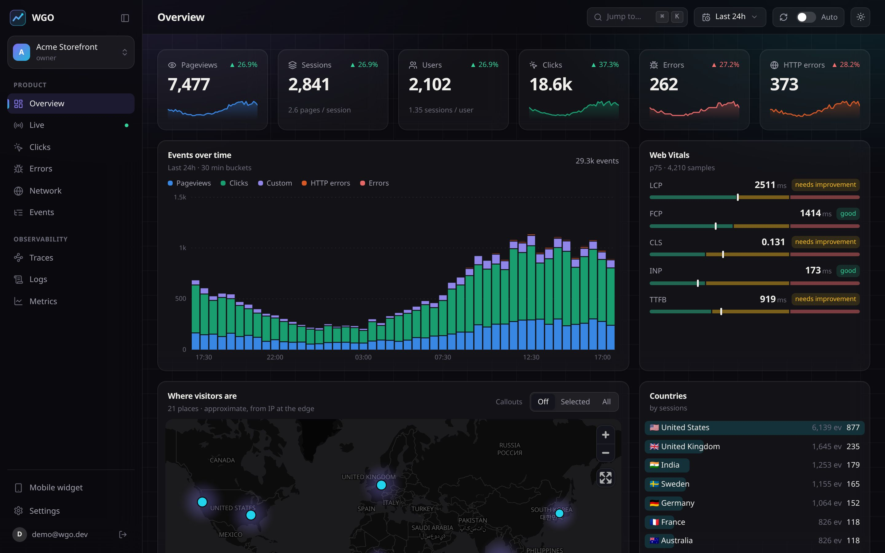
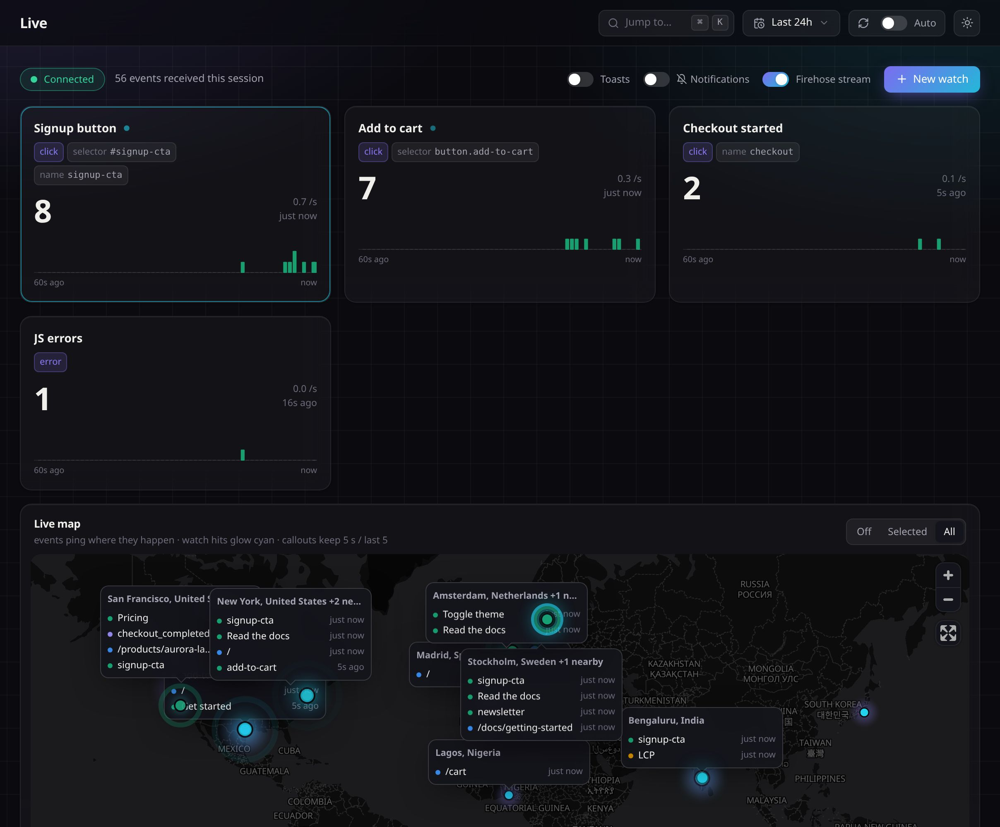
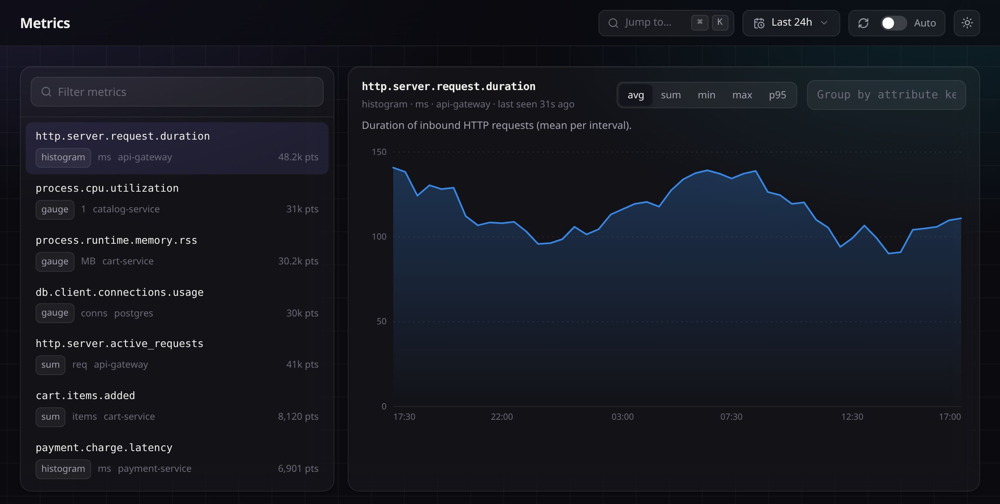
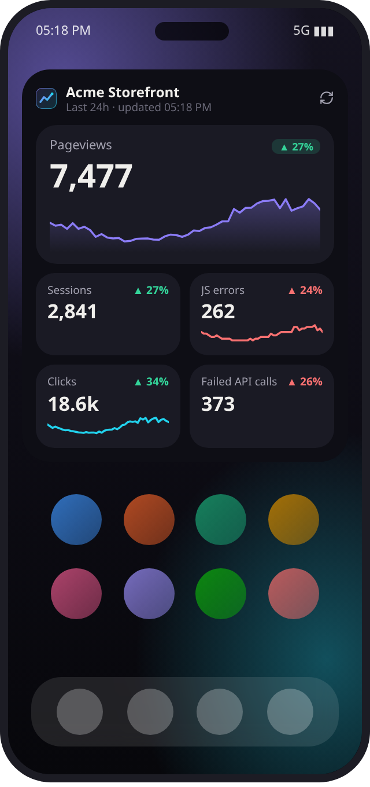
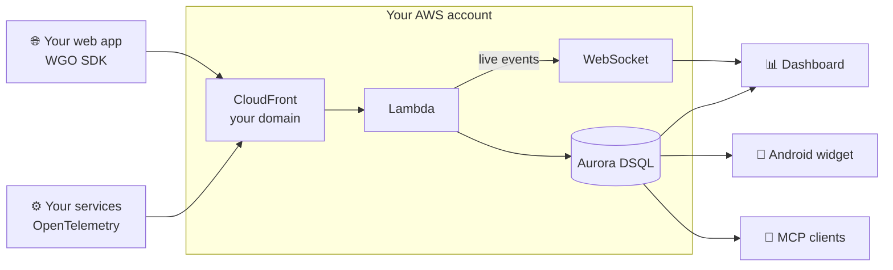

<div align="center">

# WGO

### See what's going on in your web app and the services behind it

WGO collects clicks, pageviews, errors and Web Vitals from the browser, and traces, logs and metrics from your
backends over OpenTelemetry. It all lands in one dashboard that updates as it happens.

[Web analytics](#live-web-analytics) · [OpenTelemetry](#opentelemetry-metrics-traces-and-logs) · [Android](#a-home-screen-widget-for-android) · [MCP](#ask-your-ai-assistant-with-mcp) · [Deploy it yourself](README.md#deploy-it-yourself)

</div>

<br>



---

## Live web analytics

Add one script tag and WGO records every click, pageview, JavaScript error, failed API call and Web Vital
without any extra code. Events show up within seconds.

- 👀 Watch a button, page or error and see each hit arrive, with an optional toast or browser notification.
- 🎯 Make any event a conversion goal: a signup click, a visit to /thank-you or a custom event. WGO shows the
  share of sessions that convert, how that changed since the previous period, and the trend.
- 🗺️ A live map shows where visitors are, to the nearest city. Locations come from CloudFront, and IP addresses
  are never stored.
- 🪶 The browser SDK is about 9 KB gzipped. It batches and compresses events, and holds on to them while the
  visitor is offline.

```html
<script src="https://wgo.example.com/sdk/v1/wgo.js" data-write-key="wk_…" data-endpoint="https://wgo.example.com" async></script>
```



---

## OpenTelemetry metrics, traces and logs

Point any OpenTelemetry SDK or Collector at WGO with three environment variables. Your backend telemetry sits
next to your web analytics, in the same project.

- 📈 Gauges, sums, histograms, exponential histograms and summaries. Chart the average, sum, min, max or p95,
  and split a series by any attribute.
- 🧵 Each trace opens as a span waterfall. Logs can be filtered by severity, service and text, and link to
  their trace.
- 📦 OTLP over HTTP, as protobuf or JSON, gzipped or not.

```sh
OTEL_EXPORTER_OTLP_ENDPOINT=https://wgo.example.com
OTEL_EXPORTER_OTLP_HEADERS=x-wgo-key=wk_…
OTEL_EXPORTER_OTLP_PROTOCOL=http/protobuf
```

The dashboard has a setup guide for Node.js and Python, on servers and AWS Lambda.



---

## A home-screen widget for Android

<table>
<tr>
<td width="60%" valign="top">

Keep the numbers you care about on your phone. Pick a project, a time range and up to eight stats: visitors
right now, errors, failed API calls, Web Vitals, backend latency, your tracked clicks or any OpenTelemetry
metric.

- 📐 Resize it from a single number at 2×1 up to a chart with a grid of tiles at 4×3.
- 📱 Connect the phone by scanning a QR code in the dashboard. It gets a read-only key that you can revoke at
  any time.
- 🔄 It refreshes in the background every 15 to 180 minutes, or immediately when you tap refresh. You can
  download the app after signing in.

</td>
<td width="40%" align="center">

</td>
</tr>
</table>

---

## Ask your AI assistant with MCP

Connect Claude, VS Code or any other MCP client to WGO and ask about traffic, errors, traces and metrics in
plain language. The assistant looks up the numbers itself, so you don't have to paste screenshots into the
chat.

- 🔑 You sign in with your WGO account in the browser. There is no API key to copy.
- 🔒 Access is read-only and limited to the projects you are a member of.
- 🧰 Seventeen tools cover the overview, top pages and clicks, conversion goals, errors, failed requests, Web
  Vitals, visitor locations, traces, logs and metrics.

```sh
claude mcp add --transport http wgo https://wgo.example.com/mcp
```

<table>
<tr><td>

<sub>Example conversation in an MCP client</sub>

<p align="right"><b>Checkout complaints started this afternoon. What's going on?</b></p>

<sub>🔧 <code>wgo.list_errors</code> range: "24h"</sub><br>
<sub>🔧 <code>wgo.list_failed_requests</code> range: "24h"</sub><br>
<sub>🔧 <code>wgo.list_traces</code> service: "payment-service", errors: true</sub>

🤖 Failed calls to `POST /api/checkout` went from a handful an hour to 41 since 14:00, almost all 502s. The
matching traces in payment-service spend 8–10 s waiting on the card processor before timing out.

The browser side follows from that: most new JavaScript errors are a TypeError on /checkout, thrown when the
response body is empty.

</td></tr>
</table>

---

## Your data stays in your AWS account

WGO is open source and runs on Lambda, Aurora DSQL, DynamoDB and CloudFront in the account it's deployed to.
It scales to zero when nobody is using it.



<div align="center">

**[Deploy it yourself →](README.md#deploy-it-yourself)**

<sub>Open source under the [MIT license](LICENSE)</sub>

</div>
